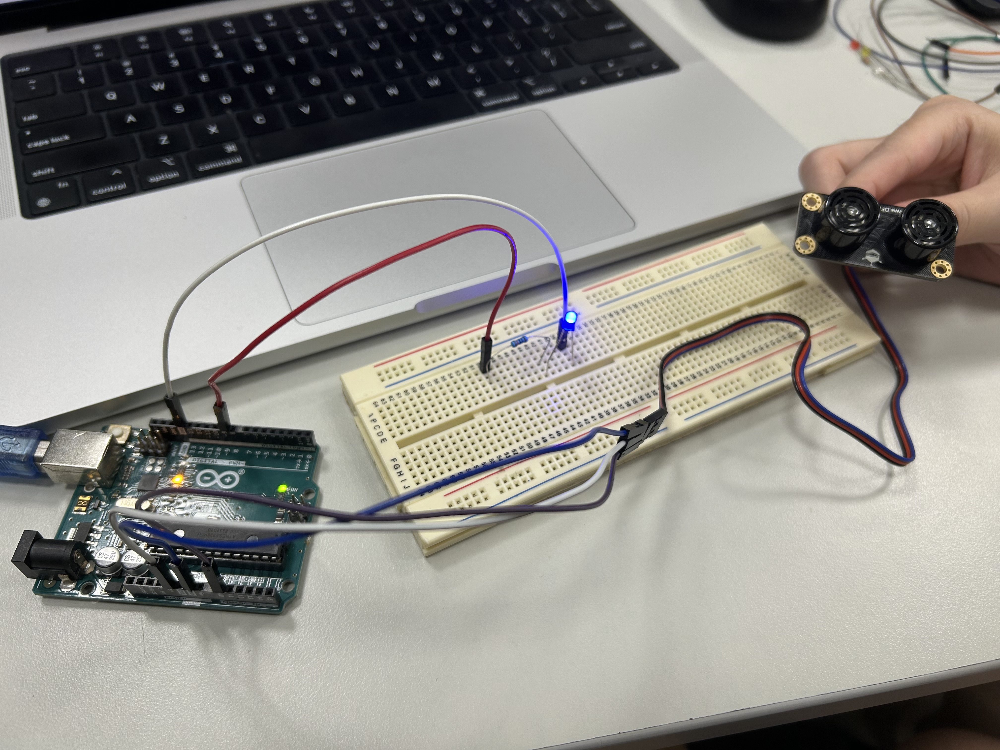
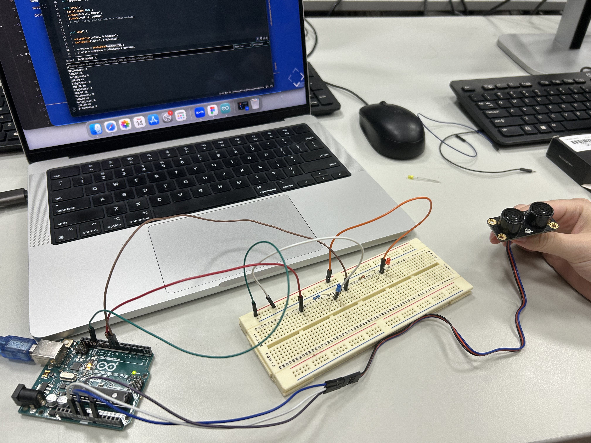

# Week9 ## — Sensor to Screen

---

### Activities

| Activity | What I Made                   |
| -------- | ----------------------------- |
| `9a`     | Make the distance from the ultrasonic sensor control the brightness of an LED. |

---

### This Week

Activity 9a — Mapping Sensors
 - We learned how to use map()function to transform the data of the sensor into the interaction on the screen.
 - We feel a stronger sense of interaction when the user movement create interaction on the digital screen through the physical sensor.
 - We treid to connect another led to experiment with the code and make myself familiar with the arduino.

---

### Output

---

<!-- ─────────────────────────────────────────────────────
     GOING FURTHER — if you want to document more, here are some ideas:

     ### 9a — Mapping Sensors

     ### 🧩 Something I Found Interesting
     In the practice, we found out when connect the sensor and led directly to the arduino uno, the interaction will run more smoother compared with connect through the breadboard. This is because the power can deliver to the sensor and led fast and stable when connecting direactly.

  
     ───────────────────────────────────────────────────── -->
