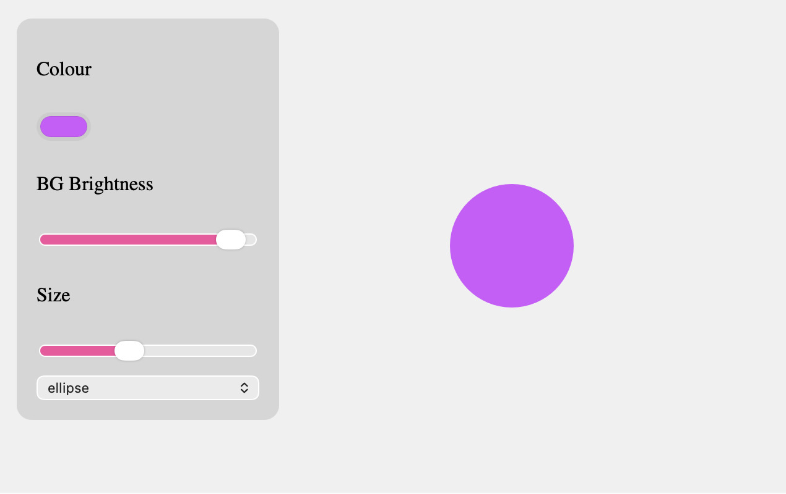
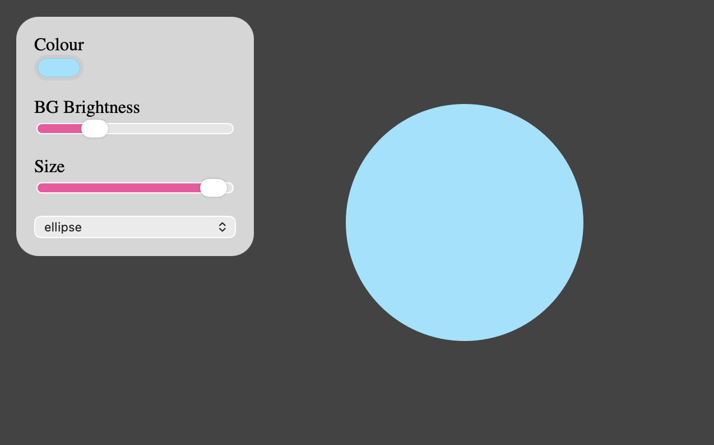
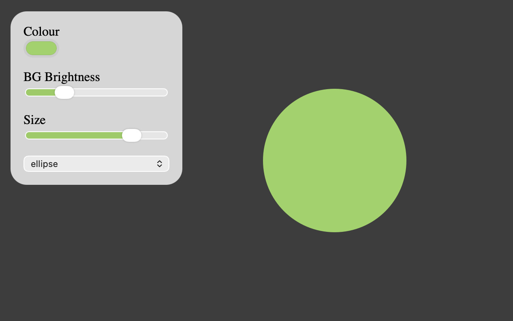

# Week10 ## — Interface Design

---

### Activities

| Activity | What I Made                   |
| -------- | ----------------------------- |
| `10`     | Apply the intuitive design and layout to the control panel to create the better experience and interface. |

---

### This Week

Activity 10 — Control Center
 - I learn how to use createDiv() to make the sliders and button organised and easy to adjust the layout.
 - Introcue the new form of interaction in p5js and DOM element which is really interesting and make me find more posiibilities and function that i can use in the interface design
 - The way data can transform into visuals make the whole interaction more intuitive.
 - I understand more ways to apply my own asethetic through css and js.
 - I spend more time on understanding the function and logic because the function become more complicated this week. However, after trying the example and spend time exploring, I learn how powerful this function can be.

---

### Output

---

<!-- ─────────────────────────────────────────────────────
     GOING FURTHER — if you want to document more, here are some ideas:

     ### 10 — Control Center

     ### 🧩 Something I Found Interesting
     In the activity, I found interesting functions in p5js library and MDN docs, which are element.input() and accent-color. I combine these two functions and manage to change the colour of the sliders according to the colour I pick for the shape.
      
      myPicker.input(sliderColour);

      function sliderColour(){
           let sliderColour = myPicker.value();
           sizeSlider.style("accent-color", sliderColour);
           bgSlider.style("accent-color", sliderColour);
      }

  
     ───────────────────────────────────────────────────── -->
