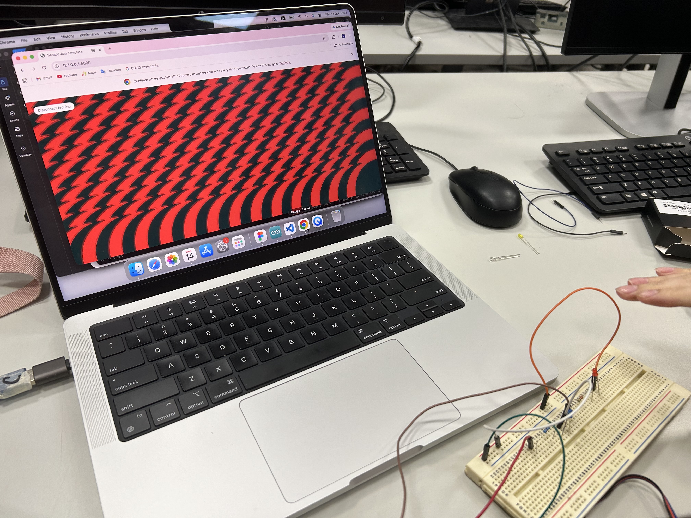
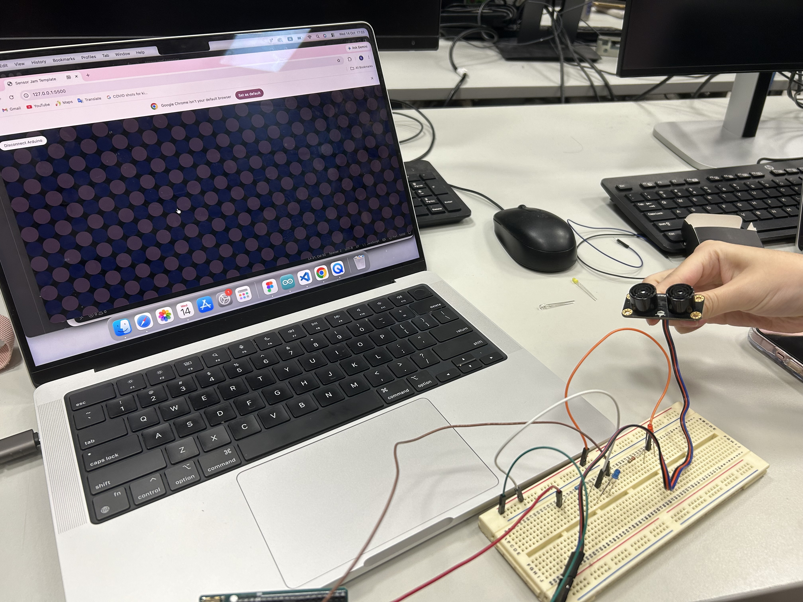
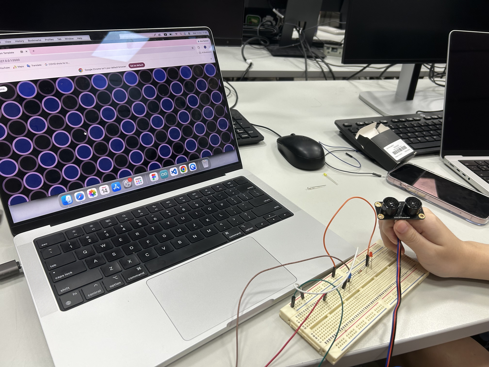

# Sensor Jam — Ｋaleidoscope

---

### The Project

- We used ultrasonic sensor to detect users distance with the arduino.
- We created the repeating ellipse pattern on the screen, alternating between blue and pink.
- When users become closer to the sensor, the ellipses will gradually become bigger and the transparency of pattern will also changes according to the distance. (The greater the distance, the more transparent the pattern.)

---

### Output





[Watch Online](https://drive.google.com/file/d/1rNDZHM7WVMih0oAtXZjPVQYrJlvrbxKA/view?usp=sharing)

---

<!-- ─────────────────────────────────────────────────────
     GOING FURTHER — want to document more? Try any of these:

     ### ✍️ Reflection
     What worked
      - We managed to make the ellipse pattern change transparency based on the distance between sensor and users.
      - We played around with making pattern more complicate and interesting by creating different colour and stroke.
      - The changing of pattern works smooth.

     What didn't
      - We tried to make only the pink ellipse with strokes, but it turns out all the pink and blue ellipses have pink stroke.

     What I'd take further
      - If have more time, we will try to slove the stroke problem in our pattern and make the pattern looks nicer and prettier.

     ### 🛠️ Hardware
     List the physical components you used.
     - Arduino Uno
     - Ultrasonic sensor (HC-SR04)

     ### 🔍 Sensor Mapping
     How does your sensor data map to visual or sonic output?
     e.g. "Distance (0–400cm) → circle size (10–400px) using map()"

     ### 🧩 Something I Found Interesting
     Because our distance between two ellipse is very close, we accidentally create an overlap effect for our pattern which turns out nice and visual appealing.
     A snippet, a technique, a happy accident.
     ```js
     function draw() {
       background(0);
       for (let y = 0; y < height; y += 100) {
         for (let x = 0; x < width; x += 100) {
           let column = x / 100;
           let row = y / 100;

           if ((column + row) % 2 == 0) {
             // ellipse(x + 50, y + 50, circleSize);
             fill(63, 89, 204, circleSize);
             ellipse(x + 50, y + 50, circleSize);
             noStroke();
           } if ((column % 2 == 0 && row == 0)) {
             // ellipse(x + 50, y + 50, circleSize);
             fill(63, 89, 204, circleSize);
             ellipse(x + 50, y + 50, circleSize);
             noStroke();
           } if ((column == 0 && row % 2 == 0)) {
             // ellipse(x + 50, y + 50, circleSize);
             stroke(255, 194, 248, circleSize);
             strokeWeight(circleSize / 10);
             noFill();
             ellipse(x + 50, y + 50, circleSize);
           } else {
             // ellipse(x + 50, y + 50, circleSize);
             stroke(255, 194, 248, circleSize);
             strokeWeight(circleSize / 10);
             noFill();
             ellipse(x + 50, y + 50, circleSize);
           }
       }
     }

     ```

